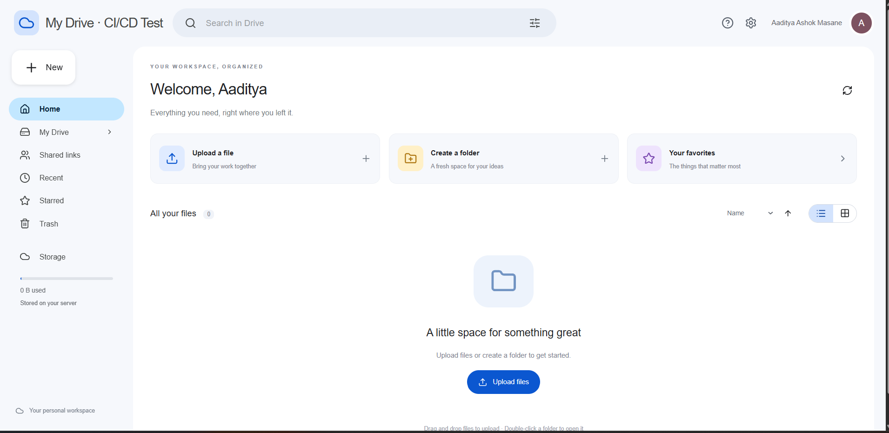
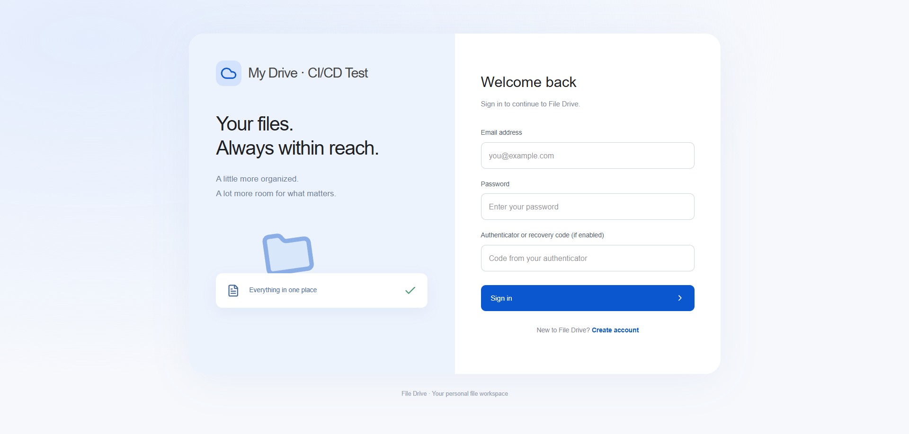
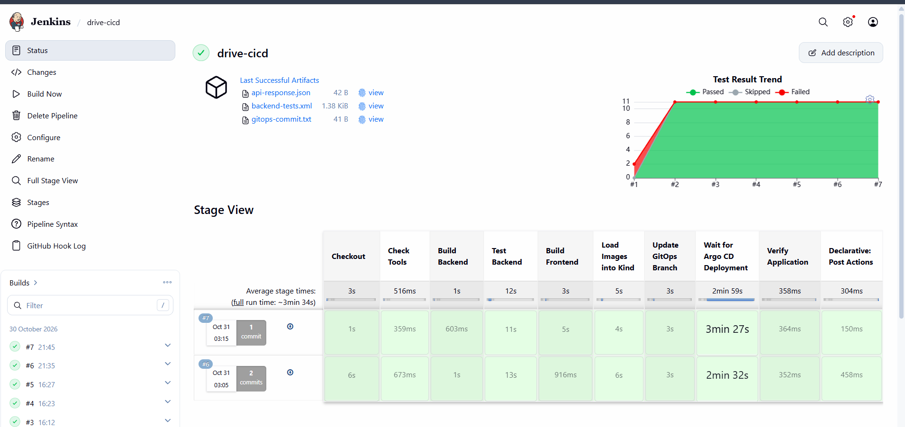
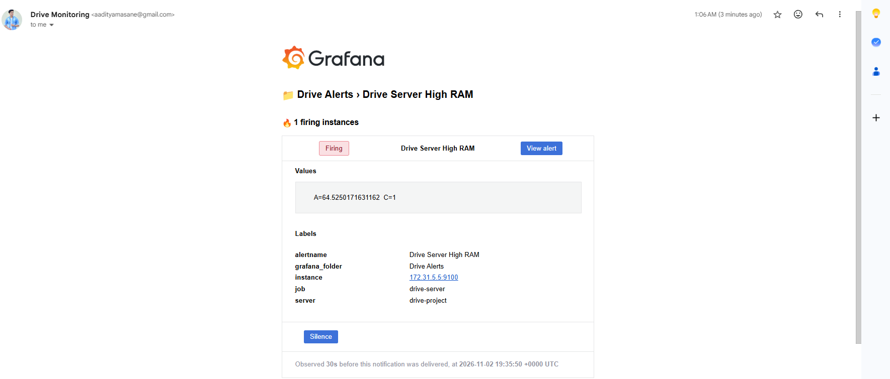
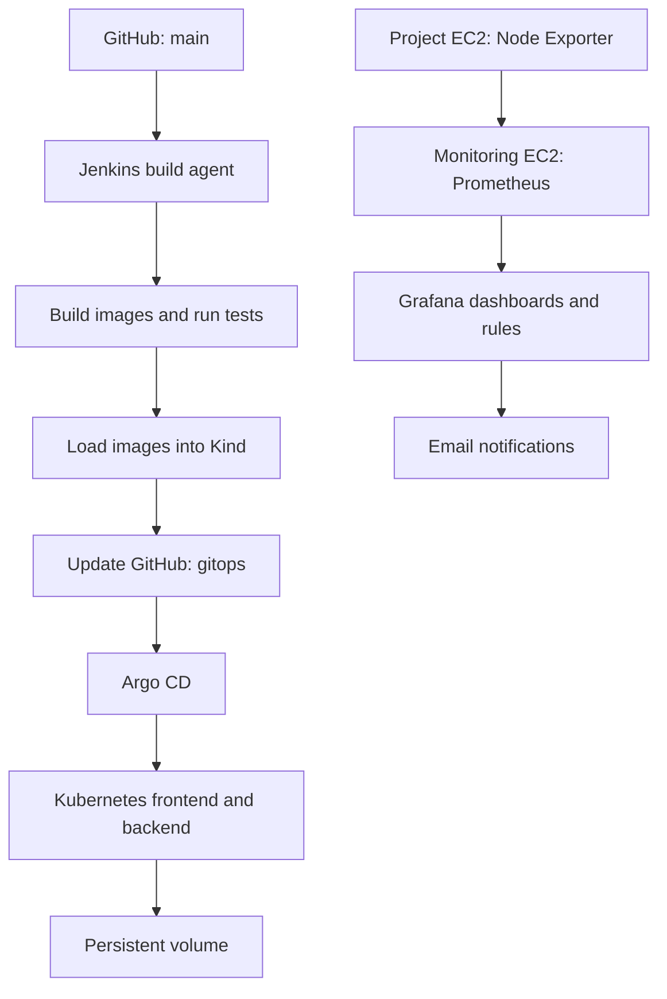

# Drive — CI/CD, GitOps & Monitoring on AWS

A FastAPI and React file storage application deployed to Kubernetes through an automated Jenkins and Argo CD workflow, with Prometheus and Grafana monitoring on a separate EC2 instance.

**GitHub → Jenkins → Docker → Kind → Argo CD → Application**

This project demonstrates how a source code change becomes a tested deployment and how server metrics are collected, visualized, and used for email alerts.

> **Deployment scope:** This is a portfolio and learning environment. The current application uses SQLite and local persistent storage on a single Kind node. Distributed storage replication and high availability are future improvements.

## Contents

- [Project Preview](#project-preview)
- [Architecture](#architecture)
- [Technology Stack](#technology-stack)
- [CI/CD Workflow](#cicd-workflow)
- [Kubernetes and Storage](#kubernetes-and-storage)
- [Argo CD and GitOps](#argo-cd-and-gitops)
- [Monitoring and Alerts](#monitoring-and-alerts)
- [Repository Structure](#repository-structure)
- [Environment Setup](#environment-setup)
- [Verification and Troubleshooting](#verification-and-troubleshooting)
- [Challenges and Solutions](#challenges-and-solutions)
- [Limitations and Next Steps](#limitations-and-next-steps)

## Project Preview

### Application Home

The React frontend provides a file management interface. Nginx serves the frontend and forwards API requests to the FastAPI backend.



<details>
<summary><strong>View the login page</strong></summary>



</details>

### Jenkins Pipeline

The pipeline builds container images, runs backend tests, updates the GitOps branch, waits for Argo CD deployment, and verifies the application.



### Grafana Email Notification

A successful contact point test verified email delivery through Gmail SMTP.

This screenshot demonstrates notification delivery. It is separate from testing the high RAM rule against collected metrics.



## Architecture



### Server Responsibilities

| Server | Components |
|---|---|
| **Project EC2** | Jenkins controller, Jenkins build agent, Docker, Kind, Argo CD, Drive application, Node Exporter |
| **Monitoring EC2** | Prometheus and Grafana through Docker Compose |

The two instances communicate over private IP addresses within the VPC.

The Jenkins controller and build agent share the project EC2. Monitoring runs on a separate instance to reduce memory pressure on the application server.

### Application Request Flow

1. The browser sends a request to the frontend on the project EC2.
2. Nginx serves the React application.
3. Requests under `/api/` are forwarded to the backend Service.
4. FastAPI handles the request and accesses the database or uploaded files.

## Technology Stack

| Layer | Technology | Purpose |
|---|---|---|
| Frontend | React, Vite | Application interface |
| Web server | Nginx | Serves frontend files and proxies API requests |
| Backend | Python, FastAPI, Uvicorn | Application API |
| Database | SQLite | Application data |
| Containers | Docker | Packages backend and frontend |
| Local deployment | Docker Compose | Application and standalone monitoring configurations |
| Kubernetes | Kind | Runs the application cluster |
| CI | Jenkins | Builds, tests, and prepares releases |
| GitOps | Argo CD | Reconciles Kubernetes resources with Git |
| Metrics | Node Exporter, Prometheus | Exposes and collects server metrics |
| Visualization | Grafana | Dashboards and alert evaluation |
| Notifications | Gmail SMTP | Email delivery |
| Hosting | AWS EC2 | Application and monitoring servers |

## CI/CD Workflow

### From Commit to Deployment

1. A change is pushed or merged into `main`.
2. A GitHub push webhook triggers Jenkins.
3. Jenkins checks out the source and generates an image tag.
4. Jenkins builds the backend image.
5. Backend application and security tests run in an isolated container.
6. Jenkins builds the frontend image.
7. Both images are loaded into Kind.
8. Jenkins updates deployment image references in the `gitops` branch.
9. Argo CD detects the desired configuration change.
10. Argo CD applies the manifests to Kubernetes.
11. Jenkins waits for the expected image versions and successful rollouts.
12. HTTP checks verify the frontend and API.

### Pipeline Stages

| Stage | Responsibility |
|---|---|
| Checkout | Retrieves application source |
| Check Tools | Verifies required tools and cluster access |
| Build Backend | Builds the FastAPI image |
| Test Backend | Runs backend tests and publishes JUnit results |
| Build Frontend | Builds the React/Nginx image |
| Load Images into Kind | Makes images available on the cluster node |
| Update GitOps Branch | Commits the selected deployment image versions |
| Wait for Argo CD Deployment | Waits for reconciliation and rollout |
| Verify Application | Checks frontend and API responses |

### Image Versioning

Images use the source commit and Jenkins build number:

```text
drive-backend:<commit>-<build-number>
drive-frontend:<commit>-<build-number>
```

This associates a deployment with the source revision and pipeline run that produced it.

### Branch Responsibilities

| Branch | Purpose |
|---|---|
| `main` | Application source and Jenkins pipeline |
| `gitops` | Kubernetes manifests with deployment image versions |
| Feature branches | Proposed changes before merging into `main` |

Jenkins watches `main` and writes deployment updates to `gitops`.

### Jenkins Configuration

The current pipeline expects:

```text
Agent label:          drive-build
GitHub credential:    github-drive
Kubernetes context:   kind-drive
Kubernetes namespace: drive
Kind cluster:         drive
```

The build agent requires Docker access, cluster access, and permission to push the GitOps branch.

### GitHub Webhook

The current lab webhook endpoint is:

```text
http://<PROJECT_EC2_PUBLIC_IP>:8080/github-webhook/
```

Configure push events with the `application/json` content type and enable the GitHub webhook trigger in Jenkins.

If the EC2 public IP changes, update the webhook URL. HTTPS and webhook signature validation remain future improvements.

## Kubernetes and Storage

The application runs in the `drive` namespace.

| Resource | Responsibility |
|---|---|
| Backend Deployment | Runs FastAPI |
| Frontend Deployment | Runs Nginx and the React frontend |
| Backend Service | Provides internal API access |
| Frontend Service | Exposes the frontend through NodePort |
| `drive-data` PVC | Persists database and upload data |
| `drive-env` Secret | Supplies backend environment settings |

### Application Access

The project EC2 maps port `8081` to the frontend NodePort inside Kind.

```text
http://<PROJECT_EC2_PUBLIC_IP>:8081
```

Permit this port only from the intended client addresses in the EC2 security group.

### Local Images

The current workflow loads images directly into Kind:

```bash
kind load docker-image \
  "drive-backend:$IMAGE_TAG" \
  "drive-frontend:$IMAGE_TAG" \
  --name drive
```

Application manifests use:

```yaml
imagePullPolicy: Never
```

The selected images must exist on the Kind node before deployment. A container registry is not currently used.

### Persistent Data

The backend mounts its data volume at `/data`.

The database uses:

```text
sqlite:////data/drive.db
```

The persistent volume preserves data across application Pod replacement. It is local to the cluster environment and does not provide an external backup or storage replication.

The current SQLite design uses one backend replica.

### Backend Secrets

Backend configuration is supplied through the `drive-env` Kubernetes Secret.

Example settings:

```dotenv
SECRET_KEY=<strong-random-secret>
ALGORITHM=HS256
ACCESS_TOKEN_EXPIRE_MINUTES=60
DATABASE_URL=sqlite:////data/drive.db
```

Additional settings must match the application configuration.

Never commit the real environment file, kubeconfig, tokens, private keys, or passwords.

## Argo CD and GitOps

Argo CD manages the desired application state from Git.

| Setting | Value |
|---|---|
| Application | `drive` |
| Source branch | `gitops` |
| Manifest path | `k8s` |
| Destination namespace | `drive` |
| Automatic sync | Enabled |
| Self-heal | Enabled |
| Automatic pruning | Disabled |

Jenkins prepares the release and commits deployment configuration. Argo CD applies that configuration to Kubernetes.

### Understanding Status

| Status | Meaning |
|---|---|
| Synced | Live resources match the desired Git configuration |
| OutOfSync | Git and live configuration differ |
| Healthy | Resources satisfy the configured health checks |
| Progressing | A rollout or operation is in progress |
| Degraded | A resource has a health problem |

Health and synchronization describe different conditions. A running application can still be OutOfSync.

### Deployment History

Older ReplicaSets may remain after a rollout. Their presence does not mean every historical application version is running.

Check Pod counts and active replicas to understand what is serving traffic.

### Rollback

Restore a known-good image reference in the `gitops` branch and let Argo CD reconcile the change.

The referenced image must still be available on the Kind node.

## Monitoring and Alerts

Monitoring runs independently of the application deployment.

### Metrics Collection

1. Node Exporter exposes project EC2 metrics on port `9100`.
2. Prometheus scrapes the private endpoint every 60 seconds.
3. Grafana queries Prometheus for dashboards and alert evaluation.

### Dashboard

The dashboard contains:

- Host RAM usage percentage.
- Host CPU usage percentage.
- A one-minute automatic refresh interval.

The dashboard JSON is stored in:

```text
platform/monitoring/grafana/drive-server-monitoring.json
```

### High RAM Alert

| Setting | Value |
|---|---|
| Name | Drive Server High RAM |
| Condition | RAM usage above 85% |
| Evaluation interval | 1 minute |
| Pending period | 5 minutes |
| Contact point | Aaditya |

The corrected alert export is stored in:

```text
platform/monitoring/grafana/alert-rules.yaml
```

The alert condition threshold is configured under **IS ABOVE**. The query’s **Min step** field is not the alert threshold.

### Email Delivery

Grafana uses Gmail SMTP with a Google app password.

Credentials remain in a private `.env` file on the monitoring server. The repository includes `.env.example` with placeholders.

The email contact point test was successfully delivered. A contact point test verifies delivery independently of the RAM rule.

### Restoration

The repository includes monitoring configuration, a dashboard export, and an alert rule export.

The exports are not automatically loaded by the current Compose configuration. Follow the restoration instructions in the monitoring README.

The alert references the **Aaditya** contact point, which must also be configured during restoration.

See [Monitoring setup and restoration](platform/monitoring/README.md).

## Repository Structure

```text
app/
frontend/
tests/
k8s/
kind/
scripts/
platform/
  monitoring/
    compose.yaml
    prometheus.yml
    .env.example
    README.md
    grafana/
      drive-server-monitoring.json
      alert-rules.yaml
      provisioning/
        datasources/
          prometheus.yaml
docs/
  App_Login_Page.png
  App_Home_Page.png
  Jenkins_pipeline.png
  Grafana_Alert.png
Dockerfile
Jenkinsfile
compose.yaml
README.md
```

## Environment Setup

### Project Server Requirements

- Docker Engine.
- Kind and kubectl.
- Jenkins controller and configured build agent.
- Argo CD.
- Access to this GitHub repository.
- Backend Kubernetes Secret.
- Node Exporter.

The Kubernetes context must point to the intended cluster before running deployment commands.

### Initial Application Configuration

Create the namespace:

```bash
kubectl create namespace drive \
  --dry-run=client -o yaml | kubectl apply -f -
```

Create the backend Secret from a private, application-specific `.env` file:

```bash
kubectl create secret generic drive-env \
  --namespace drive \
  --from-env-file=.env \
  --dry-run=client -o yaml | kubectl apply -f -
```

Build and load the selected images before Argo CD deploys manifests that reference them.

Configure the Argo CD application to track the `gitops` branch and `k8s` directory.

### Monitoring Server Requirements

- Docker Engine and Docker Compose.
- Private connectivity to project EC2 port `9100`.
- Administrator access to Grafana port `3000`.
- Outbound SMTP connectivity.
- Private Grafana and SMTP environment settings.

Detailed instructions are available in:

[platform/monitoring/README.md](platform/monitoring/README.md)

### Reproduction Scope

This README describes the implemented architecture and operating workflow. Provisioning a new environment also requires configuring EC2 networking, installing the tools, creating Jenkins credentials and its agent, and registering the Argo CD application.

## Verification and Troubleshooting

### Project Server Checks

Run on the project EC2:

```bash
sudo systemctl is-active docker jenkins drive-agent

kubectl get nodes
kubectl get deployments -n drive
kubectl get pods -n drive
kubectl get applications -n argocd
```

Check the application:

```bash
curl -I --max-time 10 http://127.0.0.1:8081/

curl -fsS --max-time 10 http://127.0.0.1:8081/api/
```

Expected API response:

```json
{"message":"Distributed File Storage API"}
```

### Pod Investigation

```bash
kubectl describe pod <POD_NAME> -n drive

kubectl logs <POD_NAME> -n drive \
  --all-containers --tail=100

kubectl get events -n drive \
  --sort-by=.metadata.creationTimestamp
```

For a previously terminated backend container:

```bash
kubectl logs <BACKEND_POD_NAME> -n drive \
  -c backend --previous --tail=100
```

A container restart normally keeps the same Pod name. Pod replacement creates a new Pod name.

### Monitoring Checks

Run from the active monitoring Compose directory on the monitoring EC2:

```bash
sudo docker compose ps

curl -fsS --max-time 10 http://127.0.0.1:9090/-/ready

curl -fsS --max-time 10 http://127.0.0.1:3000/api/health
```

In Grafana Explore:

```promql
up{job="drive-server"}
```

- `1` means the Node Exporter scrape succeeded.
- `0` means the scrape failed.

This metric checks exporter connectivity. It does not establish that the Drive application is healthy.

<details>
<summary><strong>Common problems and checks</strong></summary>

### Website Works Locally but Not Externally

Check the current public IP, EC2 security group, permitted client IP, frontend Service, and Pod readiness.

### Argo CD Is OutOfSync

Review the diff, tracked branch, manifest path, image references, and latest sync result.

### Image Is Unavailable

Confirm the selected image was loaded into the correct Kind cluster before deployment.

### Grafana Email Is Not Configured

Verify SMTP environment settings and recreate Grafana after changing them:

```bash
sudo docker compose up -d --no-deps --force-recreate grafana
```

### Prometheus Has No Project Metrics

Check the private scrape target, Node Exporter service, security group rule, and Prometheus configuration.

### Monitoring Logs

```bash
sudo docker compose logs --tail=100 prometheus
sudo docker compose logs --tail=100 grafana
```

</details>

## Challenges and Solutions

| Challenge | Resolution |
|---|---|
| Docker socket access failed | Corrected build user permissions |
| Docker Compose was unavailable | Installed the Compose package |
| Git manifests differed from live images | Aligned image references and adopted GitOps updates |
| Deployment responsibilities overlapped | Assigned builds to Jenkins and reconciliation to Argo CD |
| Full monitoring stack caused memory pressure | Moved standalone monitoring to another EC2 |
| Prometheus could not reach Node Exporter | Configured private access through security groups |
| Grafana could not send email | Added SMTP configuration and verified test delivery |
| Alert threshold was entered in the query interval field | Corrected the actual threshold and checked its YAML export |

## Security and Data Handling

- Keep real `.env` files and credentials outside Git.
- Use Jenkins credentials for GitHub authentication.
- Restrict administrative ports to intended sources.
- Restrict Node Exporter access to the monitoring server.
- Prometheus port `9090` is bound to localhost on the monitoring EC2.
- Treat Docker access and Kubernetes credentials as privileged access.
- Review screenshots before publishing personal information.

## Limitations and Next Steps

### Current Limits

- Single-node Kind cluster.
- One project EC2 hosts the application and CI services.
- SQLite and local persistent storage.
- No distributed storage replication.
- Images are stored locally on Kind.
- No off-server application backup.
- Host CPU/RAM monitoring only.
- Dashboard and alert restoration require additional steps.
- HTTPS and production-grade secret management are unfinished.

### Planned Improvements

- Kubernetes Pod readiness and restart alerts.
- Website and API availability monitoring.
- Application request and error metrics.
- Centralized logs.
- Private container registry.
- Automated backups and restore testing.
- HTTPS and stable DNS.
- Restricted Kubernetes deployment credentials.
- Automated monitoring provisioning.
- Multi-node deployment with an appropriate database and storage architecture.

## What This Project Demonstrates

- Containerizing a frontend and backend.
- Running automated backend tests in CI.
- Building traceable image versions.
- Separating CI from GitOps deployment.
- Deploying applications to Kubernetes.
- Persisting application data across Pod replacement.
- Collecting server metrics over a private network.
- Building Grafana dashboards and configuring email alerts.
- Investigating deployment, networking, and resource problems.
- Documenting configuration and operational limitations.
