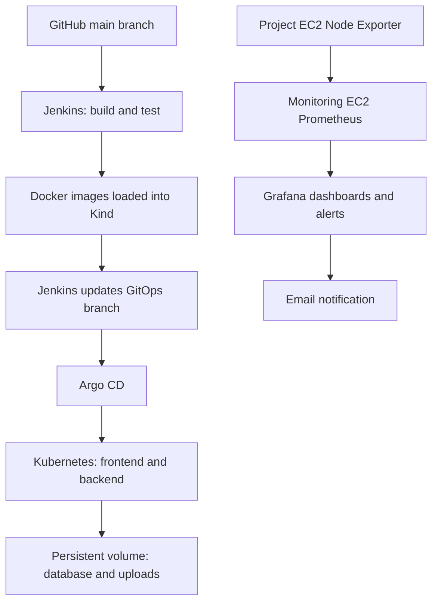

# Drive — Distributed File Storage with CI/CD, GitOps and Monitoring

A file storage application built with FastAPI and React, deployed to Kubernetes using Jenkins and Argo CD, with infrastructure monitoring through Prometheus and Grafana.

This project demonstrates an automated workflow from a GitHub commit to application deployment, with monitoring hosted on a separate EC2 instance.

> This is a learning and portfolio environment. The current deployment uses one Kubernetes node and a local SQLite database; it does not provide distributed storage replication or high availability.

## Application

- React/Vite frontend served by Nginx.
- FastAPI backend running with Uvicorn.
- SQLite database and uploaded files stored on a persistent volume.
- Nginx forwards frontend `/api/` requests to the backend.

## Architecture



## Infrastructure

| Server | Responsibilities |
|---|---|
| Project EC2 | Jenkins controller, Jenkins agent, Docker, Kind, Argo CD, application and Node Exporter |
| Monitoring EC2 | Prometheus and Grafana using Docker Compose |

Both instances communicate over private IP addresses within the VPC.

The Jenkins controller and build agent currently share the project EC2. The monitoring EC2 is separate.

## Technology Stack

| Area | Tools |
|---|---|
| Backend | Python, FastAPI, Uvicorn |
| Frontend | React, Vite, Nginx |
| Database | SQLite |
| Containers | Docker, Docker Compose |
| Kubernetes | Kind, kubectl |
| CI | Jenkins |
| GitOps deployment | Argo CD |
| Monitoring | Prometheus, Node Exporter, Grafana |
| Hosting | AWS EC2 |
| Source control | Git and GitHub |

## Repository Structure

```text
app/                    FastAPI application
frontend/               React frontend and frontend Dockerfile
tests/                  Backend tests
k8s/                    Application Kubernetes manifests
kind/                   Kind cluster configuration
scripts/                Supporting scripts
platform/monitoring/    Monitoring configuration and documentation
Dockerfile              Backend container image
Jenkinsfile             CI/CD pipeline
compose.yaml            Local application Compose configuration
README.md               Project documentation
```

See [Monitoring documentation](platform/monitoring/README.md) for monitoring setup and restoration.

## Branch Strategy

| Branch | Purpose |
|---|---|
| `main` | Application source code and Jenkins pipeline |
| `gitops` | Deployment manifests containing the selected image versions |
| Feature branches | Changes reviewed before merging into `main` |

Jenkins watches `main` and writes deployment updates to `gitops`. This separates application development from deployment updates.

## Automated Delivery Workflow

1. A developer pushes or merges changes into `main`.
2. GitHub sends a push webhook to Jenkins.
3. Jenkins checks out the source code.
4. Jenkins generates an image tag using the source commit and build number.
5. Jenkins builds the backend Docker image.
6. Backend tests run in an isolated test container.
7. Jenkins builds the frontend Docker image.
8. Both images are loaded into the Kind cluster.
9. Jenkins updates image references in the `gitops` branch.
10. Argo CD detects the manifest changes and applies them to Kubernetes.
11. Jenkins waits for the expected images and successful rollouts.
12. HTTP checks verify that the frontend and API respond.

Jenkins prepares the release and updates Git. Argo CD applies the desired application configuration to Kubernetes.

## Jenkins Pipeline

The pipeline includes these stages:

- Checkout
- Check Tools
- Build Backend
- Test Backend
- Build Frontend
- Load Images into Kind
- Update GitOps Branch
- Wait for Argo CD Deployment
- Verify Application

Backend testing includes local application and security tests. JUnit results are published in Jenkins.

### Jenkins Requirements

- Agent label: `drive-build`
- GitHub credential ID: `github-drive`
- Docker access for the build agent
- Access to the project Kind cluster
- GitHub permission to push deployment manifest updates

Do not store GitHub tokens or agent secrets in the repository.

### GitHub Webhook

Configure the repository webhook to send push events to:

```text
http://<PROJECT_EC2_PUBLIC_IP>:8080/github-webhook/
```

Use `application/json` as the content type and enable the GitHub webhook trigger in Jenkins.

Update the webhook if the EC2 public IP changes. The current lab endpoint uses HTTP; HTTPS and webhook signature validation are future improvements.

## Kubernetes Deployment

The application runs in the `drive` namespace.

| Resource | Purpose |
|---|---|
| Backend Deployment | Runs the FastAPI application |
| Frontend Deployment | Runs Nginx and serves the React application |
| Backend Service | Provides internal access to the API |
| Frontend Service | Exposes the frontend using NodePort |
| `drive-data` PVC | Stores the SQLite database and uploaded files |
| `drive-env` Secret | Supplies backend environment variables |

The frontend is accessible through the project EC2 on port `8081`, mapped to the Kind frontend NodePort.

### Container Images

Images use a tag based on the source commit and Jenkins build number:

```text
drive-backend:<commit>-<build-number>
drive-frontend:<commit>-<build-number>
```

They are loaded directly into Kind:

```bash
kind load docker-image \
  "drive-backend:$IMAGE_TAG" \
  "drive-frontend:$IMAGE_TAG" \
  --name drive
```

The application manifests use `imagePullPolicy: Never`. Images must already exist on the Kind node before deployment.

A container registry is not part of the current workflow.

### Storage

The backend mounts persistent storage at `/data`.

The database configuration uses:

```text
sqlite:////data/drive.db
```

Uploads are stored under the backend’s data directory.

The persistent volume survives application Pod replacement. It is local to the current cluster environment and is not an off-server backup.

Keep the backend at one replica with this SQLite-based design.

## Secrets

Backend configuration is supplied through the `drive-env` Kubernetes Secret.

Required settings include:

```dotenv
SECRET_KEY=<strong-random-secret>
ALGORITHM=HS256
ACCESS_TOKEN_EXPIRE_MINUTES=60
DATABASE_URL=sqlite:////data/drive.db
```

Use the complete environment settings required by the application.

For an initial setup, create the Secret from a private environment file:

```bash
kubectl create namespace drive \
  --dry-run=client -o yaml | kubectl apply -f -

kubectl create secret generic drive-env \
  --namespace drive \
  --from-env-file=.env \
  --dry-run=client -o yaml | kubectl apply -f -
```

Never commit real `.env` files, Kubernetes credentials, private keys, tokens or passwords.

## Argo CD

The `drive` Argo CD application tracks:

| Setting | Value |
|---|---|
| Repository | This GitHub repository |
| Target revision | `gitops` |
| Manifest path | `k8s` |
| Destination | Project Kubernetes cluster |
| Namespace | `drive` |
| Automatic sync | Enabled |
| Self-heal | Enabled |
| Automatic pruning | Disabled |

### Reading Application Status

- **Synced:** Live resources match the desired Git configuration.
- **OutOfSync:** Git and live resources differ.
- **Healthy:** Resources satisfy Argo CD’s health checks.
- **Progressing:** A rollout or another operation is still in progress.
- **Degraded:** A resource has a health problem requiring investigation.

Sync status and health describe different things. An application can be healthy while its configuration differs from Git.

### Deployment History

Kubernetes may retain older ReplicaSets after a rollout. Their presence does not mean multiple application versions are actively serving traffic.

Check active replicas and Pods when investigating.

### Rollback Approach

Restore a known-good image reference in the `gitops` branch and let Argo CD reconcile it.

The referenced image must still be available on the Kind node.

## Monitoring

Monitoring runs on a separate EC2 instance because running the full monitoring stack alongside Jenkins and Kubernetes caused memory pressure on the project server.

The current setup uses:

- Node Exporter on the project EC2.
- Prometheus on the monitoring EC2.
- Grafana on the monitoring EC2.
- Gmail SMTP for email notification delivery.

### Metrics Flow

Prometheus scrapes Node Exporter over the private network every 60 seconds. Grafana queries the collected metrics.

### Dashboard

The exported dashboard contains:

- Host RAM usage percentage.
- Host CPU usage percentage.
- Automatic refresh every minute.

### High RAM Alert

| Setting | Value |
|---|---|
| Name | Drive Server High RAM |
| Threshold | Above 85% RAM usage |
| Evaluation interval | 1 minute |
| Pending period | 5 minutes |
| Contact point | Aaditya |

Email contact point delivery was tested successfully.

The exported rule references the contact point by name. A restored installation must configure that contact point and SMTP credentials separately.

### Monitoring Scope

Current monitoring covers host CPU and RAM.

Kubernetes Pod readiness, container restart alerts, website availability and application request metrics are future additions.

See [platform/monitoring/README.md](platform/monitoring/README.md) for installation, dashboard restoration and alert configuration.

## Verification Commands

Run application and Kubernetes checks on the **project EC2**:

```bash
sudo systemctl is-active docker jenkins drive-agent

kubectl get nodes
kubectl get pods -n drive
kubectl get deployments -n drive
kubectl get applications -n argocd

curl -fsS --max-time 10 http://127.0.0.1:8081/api/
```

Expected API response:

```json
{"message":"Distributed File Storage API"}
```

Run monitoring checks on the **monitoring EC2**, from the monitoring Compose directory:

```bash
sudo docker compose ps

curl -fsS --max-time 10 http://127.0.0.1:9090/-/ready
curl -fsS --max-time 10 http://127.0.0.1:3000/api/health
```

## Troubleshooting

### Pod Failure or Restart

```bash
kubectl get pods -n drive
kubectl describe pod <POD_NAME> -n drive
kubectl logs <POD_NAME> -n drive --all-containers --tail=100
kubectl get events -n drive --sort-by=.metadata.creationTimestamp
```

For a previously terminated backend container:

```bash
kubectl logs <BACKEND_POD_NAME> -n drive \
  -c backend --previous --tail=100
```

A container restart normally keeps the same Pod name. Pod replacement creates a new Pod name.

### Website Works Locally but Not in the Browser

Check:

- The EC2 instance’s current public IP.
- The security group rule for TCP `8081`.
- Whether the permitted administrator IP is current.
- The frontend Service and Pod readiness.

### Argo CD Shows OutOfSync

Review the application diff and confirm:

- The application tracks the intended branch and path.
- Jenkins pushed the expected image references.
- Both images were loaded into Kind.
- The sync operation completed successfully.

### Grafana Email Failure

Confirm SMTP settings are configured in the running Grafana container.

After changing Compose environment variables, recreate Grafana:

```bash
sudo docker compose up -d --no-deps --force-recreate grafana
```

Use a Google app password rather than the normal Google account password.

## Challenges and Lessons

- Resolved Docker socket permission and Compose installation issues.
- Separated Jenkins build responsibilities from Argo CD deployment responsibilities.
- Aligned Git manifests with deployed image versions.
- Used a dedicated GitOps branch for deployment updates.
- Investigated memory pressure and moved monitoring to another EC2.
- Configured private network access to Node Exporter.
- Configured Grafana SMTP and verified test email delivery.
- Exported dashboards and alerts for version control.

## Current Limitations

- Single-node Kind cluster and single application EC2.
- No automatic recovery from complete EC2 failure.
- Local container images without a registry.
- SQLite backend designed for one replica.
- Local persistent storage without an external backup.
- Monitoring focuses on host CPU and RAM.
- Dashboard and alert exports require restoration steps.
- HTTPS and production-grade credential management are not yet implemented.

## Future Improvements

- Pod readiness and restart monitoring.
- Website availability checks.
- Application metrics and centralized logs.
- Private image registry.
- Automated database and upload backups with restore testing.
- HTTPS and stable DNS.
- Restricted deployment credentials.
- Automated monitoring provisioning and deployment.
- Multi-node deployment with an appropriate shared database and storage design.

## Project Outcome

The project demonstrates application containerization, automated testing, Jenkins CI, Kubernetes deployment through Argo CD, persistent application storage, and host monitoring with email notifications.

It is an end-to-end DevOps portfolio project with documented operational limits and a clear path for further improvements.
