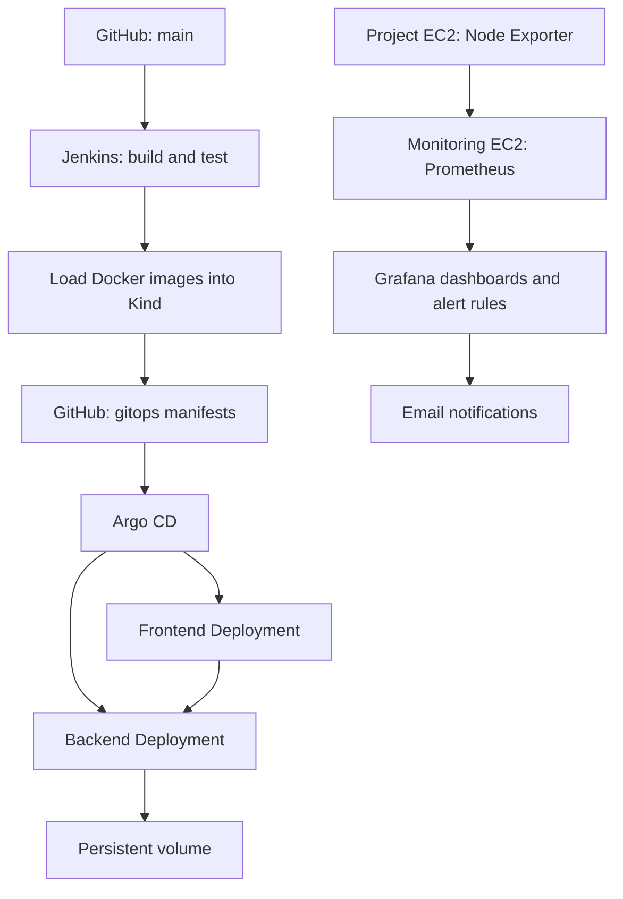

# Drive — Automated CI/CD, GitOps and Monitoring

A FastAPI and React file storage application deployed to Kubernetes using Jenkins and Argo CD, with Prometheus and Grafana monitoring on a separate AWS EC2 instance.

The project demonstrates the complete delivery workflow: source changes trigger automated builds and tests, deployment configuration is updated in Git, and Argo CD reconciles the application with Kubernetes.

> **Project scope:** This is a DevOps learning and portfolio environment. The application currently uses SQLite and local persistent storage on a single Kind node. Distributed storage replication and high availability are not implemented.

## Contents

- [Application](#application)
- [Architecture](#architecture)
- [Technology Stack](#technology-stack)
- [Jenkins CI/CD Pipeline](#jenkins-cicd-pipeline)
- [Argo CD and GitOps](#argo-cd-and-gitops)
- [Kubernetes Deployment](#kubernetes-deployment)
- [Prometheus and Grafana](#prometheus-and-grafana)
- [Grafana Email Alerts](#grafana-email-alerts)
- [Repository Structure](#repository-structure)
- [Configuration and Secrets](#configuration-and-secrets)
- [Verification](#verification)
- [Troubleshooting](#troubleshooting)
- [Challenges and Solutions](#challenges-and-solutions)
- [Current Limitations](#current-limitations)
- [Future Improvements](#future-improvements)

## Application

Drive provides a browser-based file management interface backed by a FastAPI API.

### Application Home

The frontend provides navigation for files, folders, shared links, recent items, favorites and trash.


### Login Page

The application includes a sign-in interface for accessing a user’s workspace.


### Application Components

| Component | Responsibility |
|---|---|
| React and Vite | Build the browser interface |
| Nginx | Serve frontend assets and forward API requests |
| FastAPI and Uvicorn | Handle backend API requests |
| SQLite | Store application records |
| Persistent volume | Store the database and uploaded files |

The browser accesses the frontend. Requests under `/api/` are forwarded by Nginx to the backend Kubernetes Service.

## Architecture



### Infrastructure Layout

| Server | Components |
|---|---|
| Project EC2 | Jenkins controller, Jenkins build agent, Docker, Kind, Argo CD, application and Node Exporter |
| Monitoring EC2 | Prometheus and Grafana through Docker Compose |

Both instances communicate over the VPC’s private network.

Jenkins and its build agent currently share the project server. Monitoring runs on a separate EC2 instance to reduce memory pressure on the application server.

## Technology Stack

| Area | Technology |
|---|---|
| Backend | Python, FastAPI, Uvicorn |
| Frontend | React, Vite |
| Web server | Nginx |
| Database | SQLite |
| Containers | Docker |
| Compose deployment | Docker Compose |
| Kubernetes cluster | Kind |
| Continuous integration | Jenkins |
| GitOps deployment | Argo CD |
| Metrics collection | Prometheus and Node Exporter |
| Dashboards and alerts | Grafana |
| Email delivery | Gmail SMTP |
| Hosting | AWS EC2 |
| Source control | Git and GitHub |

## Jenkins CI/CD Pipeline

Jenkins automates image builds, backend testing, release preparation and deployment verification.

### Pipeline Screenshot

The screenshot shows successful pipeline stages, published artifacts and the test result history.


### Delivery Workflow

1. A developer pushes or merges a change into `main`.
2. GitHub sends a push webhook to Jenkins.
3. Jenkins checks out the application source.
4. Jenkins creates an image tag from the source commit and build number.
5. The backend Docker image is built.
6. Backend application and security tests run in an isolated container.
7. The frontend Docker image is built.
8. Both images are loaded into Kind.
9. Jenkins updates image references in the `gitops` branch.
10. Argo CD detects and applies the deployment changes.
11. Jenkins waits for the expected images and successful rollouts.
12. HTTP checks verify the frontend and backend API.

### Pipeline Stages

| Stage | Purpose |
|---|---|
| Checkout | Retrieve application source |
| Check Tools | Verify required tools and cluster access |
| Build Backend | Build the FastAPI container image |
| Test Backend | Execute tests and publish JUnit results |
| Build Frontend | Build the React/Nginx container image |
| Load Images into Kind | Make images available to Kubernetes |
| Update GitOps Branch | Commit deployment image references |
| Wait for Argo CD Deployment | Wait for reconciliation and rollout |
| Verify Application | Check frontend and API responses |

### Image Tags

Images use the following naming pattern:

```text
drive-backend:<commit>-<build-number>
drive-frontend:<commit>-<build-number>
```

This connects a deployed image to its source revision and Jenkins build.

### Jenkins Requirements

| Setting | Value |
|---|---|
| Agent label | `drive-build` |
| GitHub credential ID | `github-drive` |
| Kubernetes context | `kind-drive` |
| Kubernetes namespace | `drive` |
| Kind cluster | `drive` |

The build agent requires Docker access, Kubernetes access and permission to push deployment changes to GitHub.

Credentials are configured in Jenkins rather than committed to the repository.

### GitHub Webhook

The current lab webhook endpoint is:

```text
http://<PROJECT_EC2_PUBLIC_IP>:8080/github-webhook/
```

The webhook sends push events using `application/json`.

If the EC2 public IP changes, update the webhook URL. HTTPS and webhook signature validation remain future improvements.

## Argo CD and GitOps

Argo CD continuously compares the Kubernetes application with its desired configuration in Git.

Jenkins builds the release and updates Git. Argo CD applies the desired deployment configuration.

### Branch Strategy

| Branch | Responsibility |
|---|---|
| `main` | Application source and Jenkins pipeline |
| `gitops` | Deployment manifests containing selected image versions |
| Feature branches | Changes reviewed before merging |

The separate GitOps branch allows deployment updates without committing generated image references back to the application source branch.

### Argo CD Application

| Setting | Value |
|---|---|
| Application name | `drive` |
| Target branch | `gitops` |
| Manifest directory | `k8s` |
| Destination namespace | `drive` |
| Automatic sync | Enabled |
| Self-heal | Enabled |
| Automatic pruning | Disabled |

### Understanding Status

| Status | Meaning |
|---|---|
| Synced | Live resources match the desired Git configuration |
| OutOfSync | Git and the live configuration differ |
| Healthy | Resources satisfy their health checks |
| Progressing | A rollout or operation is in progress |
| Degraded | A resource has a health problem |

Synchronization and health describe different conditions. An application can remain healthy while its live configuration differs from Git.

### Deployment History and Rollback

Kubernetes may retain older ReplicaSets after deployments. Check active replicas and Pods to determine which version is running.

To roll back, restore a known-good image reference in the `gitops` branch and let Argo CD reconcile it.

The selected image must still be available on the Kind node.

## Kubernetes Deployment

The frontend and backend run in the `drive` namespace.

| Resource | Purpose |
|---|---|
| Frontend Deployment | Run Nginx and serve the React interface |
| Backend Deployment | Run the FastAPI application |
| Frontend Service | Expose the application through NodePort |
| Backend Service | Provide internal API access |
| `drive-data` PVC | Persist application data |
| `drive-env` Secret | Supply backend environment variables |

### Application Access

The project EC2 maps port `8081` to the frontend NodePort inside Kind.

```text
http://<PROJECT_EC2_PUBLIC_IP>:8081
```

### Image Availability

Jenkins loads images directly into the cluster:

```bash
kind load docker-image \
  "drive-backend:$IMAGE_TAG" \
  "drive-frontend:$IMAGE_TAG" \
  --name drive
```

The application manifests use:

```yaml
imagePullPolicy: Never
```

Images must exist on the Kind node before deployment. The current workflow does not use a container registry.

### Persistent Storage

The backend mounts persistent storage at `/data`.

The database connection is configured as:

```text
sqlite:////data/drive.db
```

The volume preserves database and upload data across application Pod replacement.

This storage remains local to the cluster environment. It does not provide an external backup, replication or recovery from complete server loss.

The SQLite-based backend currently uses one replica.

## Prometheus and Grafana

Monitoring is hosted on a separate EC2 instance.

An initial attempt to run the full monitoring stack on the project server caused memory pressure. The current design uses standalone Prometheus and Grafana containers on the monitoring server.

### Metrics Collection

1. Node Exporter reads host metrics on the project EC2.
2. Prometheus scrapes the private Node Exporter endpoint every 60 seconds.
3. Grafana queries Prometheus to display CPU and RAM usage.
4. Grafana evaluates the configured alert rule.

### Dashboard Panels

| Panel | Measurement |
|---|---|
| RAM Usage | Host memory usage percentage |
| CPU Usage | Host CPU usage averaged over five minutes |

The dashboard refreshes every minute.

### Monitoring Files

| File | Purpose |
|---|---|
| `platform/monitoring/compose.yaml` | Run Prometheus and Grafana |
| `platform/monitoring/prometheus.yml` | Configure scrape targets |
| `platform/monitoring/.env.example` | Document required environment variables |
| `platform/monitoring/grafana/provisioning/datasources/prometheus.yaml` | Provision the Prometheus data source |
| `platform/monitoring/grafana/drive-server-monitoring.json` | Exported dashboard |
| `platform/monitoring/grafana/alert-rules.yaml` | Exported RAM alert rule |

Dashboard and alert exports require restoration steps. Uploading them to GitHub alone does not load them into Grafana.

See [Monitoring setup and restoration](platform/monitoring/README.md).

## Grafana Email Alerts

Grafana uses Gmail SMTP to deliver email notifications.

### Email Notification Screenshot

The screenshot below shows a successfully delivered Grafana contact point test.


This verifies email delivery. The contact point test is separate from triggering the RAM alert using collected server metrics.

### High RAM Rule

| Setting | Value |
|---|---|
| Rule name | Drive Server High RAM |
| Condition | RAM usage above 85% |
| Evaluation interval | 1 minute |
| Pending period | 5 minutes |
| Contact point | Aaditya |

The rule fires when the threshold condition remains true across evaluations for the pending period.

### Credentials

SMTP credentials remain in a private `.env` file on the monitoring server.

```dotenv
GRAFANA_ADMIN_PASSWORD=<strong-password>
GRAFANA_SMTP_USER=<gmail-address>
GRAFANA_SMTP_PASSWORD=<google-app-password>
```

The real file is excluded from version control. Only placeholder values belong in `.env.example`.

### Restoring Alerts

The exported rule references the **Aaditya** contact point by name.

A restored installation must configure:

- The Prometheus data source.
- SMTP environment settings.
- An Email contact point named `Aaditya`.
- The exported alert rule.

### Safe Alert Testing

Temporarily lower the alert threshold below current RAM usage to test evaluation and notification delivery.

After testing, restore:

```text
Threshold:      85%
Pending period: 5 minutes
```

Increasing server memory consumption is unnecessary for this test.

## Repository Structure

```text
app/
frontend/
tests/
k8s/
kind/
scripts/
platform/
  monitoring/
    compose.yaml
    prometheus.yml
    .env.example
    README.md
    grafana/
      drive-server-monitoring.json
      alert-rules.yaml
      provisioning/
        datasources/
          prometheus.yaml
docs/
  App_Home_Page.png
  App_Login_Page.png
  Jenkins_pipeline.png
  Grafana_Alert.png
Dockerfile
Jenkinsfile
compose.yaml
README.md
```

## Configuration and Secrets

### Backend Configuration

The backend receives configuration through the `drive-env` Kubernetes Secret.

Example settings:

```dotenv
SECRET_KEY=<strong-random-secret>
ALGORITHM=HS256
ACCESS_TOKEN_EXPIRE_MINUTES=60
DATABASE_URL=sqlite:////data/drive.db
```

Include any additional environment settings required by the application.

For initial setup, create the namespace:

```bash
kubectl create namespace drive \
  --dry-run=client -o yaml | kubectl apply -f -
```

Create the Secret from a private environment file:

```bash
kubectl create secret generic drive-env \
  --namespace drive \
  --from-env-file=.env \
  --dry-run=client -o yaml | kubectl apply -f -
```

### Environment Requirements

The project server needs Docker, Kind, kubectl, Jenkins, its configured agent, Argo CD and Node Exporter.

The monitoring server needs Docker Compose, private connectivity to Node Exporter, and SMTP connectivity.

Setting up a fresh environment also requires EC2 networking, Jenkins credentials, agent registration and the Argo CD application configuration.

### Secret Handling

Never commit:

- Real `.env` files.
- Gmail app passwords.
- GitHub tokens.
- Grafana passwords.
- Kubernetes credentials.
- SSH private keys.

Review screenshots for personal information before publishing them.

## Verification

### Project EC2

```bash
sudo systemctl is-active docker jenkins drive-agent

kubectl get nodes
kubectl get deployments -n drive
kubectl get pods -n drive
kubectl get applications -n argocd
```

Verify the frontend:

```bash
curl -I --max-time 10 http://127.0.0.1:8081/
```

Verify the backend through Nginx:

```bash
curl -fsS --max-time 10 http://127.0.0.1:8081/api/
```

Expected API response:

```json
{"message":"Distributed File Storage API"}
```

### Monitoring EC2

Run from the active monitoring Compose directory:

```bash
sudo docker compose ps

curl -fsS --max-time 10 http://127.0.0.1:9090/-/ready

curl -fsS --max-time 10 http://127.0.0.1:3000/api/health
```

In Grafana Explore:

```promql
up{job="drive-server"}
```

| Value | Meaning |
|---|---|
| `1` | Prometheus successfully scraped Node Exporter |
| `0` | The scrape failed |

This checks exporter connectivity. It does not verify application availability.

## Troubleshooting

<details>
<summary><strong>Pod failure or repeated restarts</strong></summary>

```bash
kubectl get pods -n drive

kubectl describe pod <POD_NAME> -n drive

kubectl logs <POD_NAME> -n drive \
  --all-containers --tail=100

kubectl get events -n drive \
  --sort-by=.metadata.creationTimestamp
```

For a previously terminated backend container:

```bash
kubectl logs <BACKEND_POD_NAME> -n drive \
  -c backend --previous --tail=100
```

A container restart normally keeps the same Pod name. Pod replacement creates a new name.

</details>

<details>
<summary><strong>Website works locally but not externally</strong></summary>

Check:

- The current EC2 public IP.
- Security group access to port `8081`.
- Whether the permitted client IP has changed.
- Frontend Service configuration.
- Pod readiness.

</details>

<details>
<summary><strong>Argo CD shows OutOfSync</strong></summary>

Review the application diff and confirm:

- The application tracks `gitops`.
- The manifest path is `k8s`.
- Jenkins pushed the intended image references.
- Images were loaded into the correct Kind cluster.
- The latest sync completed successfully.

</details>

<details>
<summary><strong>Prometheus cannot collect project metrics</strong></summary>

Check Node Exporter, its listening address, the private target in `prometheus.yml`, and security group access from the monitoring server.

Validate the configuration:

```bash
sudo docker compose exec prometheus \
  promtool check config /etc/prometheus/prometheus.yml
```

After a valid configuration change:

```bash
sudo docker compose restart prometheus
```

</details>

<details>
<summary><strong>Grafana email delivery fails</strong></summary>

Verify SMTP settings and use a Google app password.

After changing Compose environment settings:

```bash
sudo docker compose up -d --no-deps --force-recreate grafana
```

Check logs:

```bash
sudo docker compose logs --tail=100 grafana
```

Do not publish credentials while sharing diagnostic output.

</details>

## Challenges and Solutions

| Challenge | Resolution |
|---|---|
| Docker access failed | Corrected build user permissions |
| Compose was unavailable | Installed the Compose package |
| Live image versions differed from Git | Aligned manifests and adopted GitOps updates |
| Deployment responsibilities overlapped | Used Jenkins for builds and Argo CD for reconciliation |
| Monitoring caused memory pressure | Moved monitoring to a separate EC2 |
| Node Exporter was unreachable | Configured private security group access |
| Grafana SMTP was missing | Added email settings and verified delivery |
| Alert threshold was entered in Min step | Corrected the condition and verified the YAML export |

## Current Limitations

- Single-node Kind cluster.
- Application and CI services share one EC2.
- SQLite backend with one replica.
- Local storage without distributed replication.
- No external application backup.
- Container images loaded directly into Kind.
- Monitoring currently covers host CPU and RAM.
- Pod health and website availability alerts are unfinished.
- Monitoring exports require restoration steps.
- HTTPS and production-grade secret management are unfinished.

## Future Improvements

- Pod readiness and container restart alerts.
- Website and API availability monitoring.
- Application request, latency and error metrics.
- Centralized logging.
- Private container registry.
- Automated backups with restore testing.
- HTTPS and stable DNS.
- Restricted Kubernetes deployment credentials.
- Automated monitoring provisioning.
- Multi-node deployment with an appropriate database and storage design.

## Skills Demonstrated

- Docker image creation for frontend and backend services.
- Automated backend testing in Jenkins.
- Traceable image versioning.
- Kubernetes application deployment and persistent storage.
- GitOps reconciliation with Argo CD.
- Private network metrics collection.
- Grafana dashboards and email notification configuration.
- Deployment, resource and networking troubleshooting.
- Configuration management and technical documentation.
